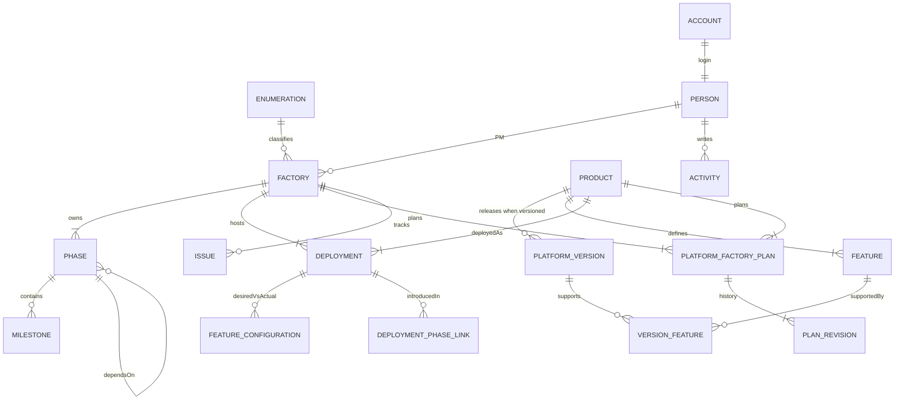

# 廠務協調台

P0 coordination workspace for several factories moving through the same four phases. The screen that matters most is **產品建立 (Phase 2)**: each factory × product cell shows the deployment, the product team's plan, and whether that plan is ready for **開發者進駐**.

The GitHub Pages build keeps an in-browser mock. The Go binary in this repo serves the same JSON API from SQLite and embeds that frontend. See [docs/deployment-architecture.md](docs/deployment-architecture.md).

## Run

GitHub Pages / local mock (base path `/tomMo-`):

```bash
go run ./cmd/fpmctl fixture -out src/mocks/demo.json
npm install
npm run dev
```

Open [http://localhost:3000/tomMo-/login/](http://localhost:3000/tomMo-/login/).

```bash
npm test
npm run lint
npm run build   # static export in out/, mock mode
```

Go monolith (app at `/`, cookie session, SQLite):

```bash
NEXT_PUBLIC_USE_MOCK=0 NEXT_PUBLIC_BASE_PATH= npm run build
rm -rf web/dist && cp -a out web/dist
DEV_DEFAULT_PASSWORDS=true go run ./cmd/server
```

Or `docker build -t fpm .` then `docker run --rm -p 8080:8080 -e DEV_DEFAULT_PASSWORDS=true -e SESSION_SECRET=dev-session-secret fpm`.

Open [http://localhost:8080/login/](http://localhost:8080/login/).

Accounts when `SEED_MODE=demo`: `admin`（編輯者，林品均）and `viewer`（使用者，陳浩宇）. Initial passwords come from `INITIAL_ADMIN_PASSWORD` / `INITIAL_VIEWER_PASSWORD` (or `*_FILE` pointing at a mounted secret file) and are used only when the account does not exist yet. If unset, random passwords are generated and written to `$DATA_DIR/initial-credentials.txt` (0600); the log only shows that path. For local dev, `DEV_DEFAULT_PASSWORDS=true` uses `admin` / `admin` and `viewer` / `viewer`; `LOG_INITIAL_PASSWORDS=true` prints generated passwords (dev only).

Kubernetes install with random secrets:

```bash
kubectl create secret generic fpm-auth \
  --from-literal=INITIAL_ADMIN_PASSWORD="$(openssl rand -base64 24)" \
  --from-literal=INITIAL_VIEWER_PASSWORD="$(openssl rand -base64 24)" \
  --from-literal=SESSION_SECRET="$(openssl rand -base64 48)"
```

Retrieve them later:

```bash
kubectl get secret fpm-auth -o jsonpath='{.data.INITIAL_ADMIN_PASSWORD}' | base64 -d; echo
kubectl get secret fpm-auth -o jsonpath='{.data.INITIAL_VIEWER_PASSWORD}' | base64 -d; echo
```

See [docs/deployment-architecture.md](docs/deployment-architecture.md). `SEED_MODE=none` links `admin` to 系統管理員. When `INITIAL_VIEWER_PASSWORD` is set it also creates `viewer`, linked to 唯讀帳號. An empty viewer password does not create a viewer account.

編輯者 can create and edit, including 管理. 使用者 is read-only. The mock stores edits in `localStorage`. **重設示範資料** is editor-only, and only when the process was started with `SEED_MODE=demo`.

## 初始化資料

資料只從 CSV（或同一欄位的 xlsx）進來。`data/demo/*.csv` 是展示資料的唯一來源。伺服器啟動、`fpmctl import`、Go 測試，以及 GitHub Pages 的 mock，都走 `internal/impex` 這套匯入。

`SEED_MODE` 只在 `app.db` 還沒有資料時作用：

| 值 | 空資料庫會有什麼 |
| --- | --- |
| `demo` | 讀取嵌進 binary 的 `data/demo/*.csv`。本機 `go run` 與測試的預設。 |
| `none` | 列舉、四個階段模板，以及人員「系統管理員」、「唯讀帳號」。Kubernetes manifest 設這個。 |

已有資料的資料庫不會被清掉，也不會重灌。`none` 底下按「重設示範資料」會回 `400`「這個環境沒有示範資料可重設」。

帳號用姓名對人。`demo` 把 admin 對到林品均、viewer 對到陳浩宇。`none` 把 admin 對到系統管理員；有設定 `INITIAL_VIEWER_PASSWORD` 時也建立 viewer，對到唯讀帳號。viewer 密碼留空時不建立 viewer 帳號，也不會替它產生隨機密碼。

### 本機灌入展示資料

空資料庫直接：

```bash
SEED_MODE=demo go run ./cmd/server
```

或對已經在跑、且 `SEED_MODE=none` 的服務用同一批 CSV（合併，不刪除檔案裡沒有的列）：

```bash
go build -o fpmctl ./cmd/fpmctl
./fpmctl import --dir data/demo --base http://127.0.0.1:8080 --user admin --password admin
```

`--dry-run` 只印出會建立或更新的列。格式錯誤會帶檔名與列號，此時還沒有登入。

### 準備正式資料

1. 複製 `data/templates/`。每個檔有表頭和幾列範例，欄位用名稱互相參考，不用 id。
2. 依實際人員、工廠、產品、階段、施工計畫、機台數量、議題改寫。`versions.csv`、`issues.csv`、`milestones.csv` 可以不放。
3. 先乾跑，再匯入。同一目錄可以重跑；同名的列會更新，檔案裡沒有的列會留下。

```bash
./fpmctl import --dir ./my-data --dry-run --base http://127.0.0.1:8080 --user admin --password "$ADMIN_PASSWORD"
./fpmctl import --dir ./my-data --base http://127.0.0.1:8080 --user admin --password "$ADMIN_PASSWORD"
```

也可以改給單一 xlsx，每個工作表對一個 CSV 檔名（去掉 `.csv`）：

```bash
./fpmctl import --xlsx ./my-data.xlsx --base http://127.0.0.1:8080 --user admin --password "$ADMIN_PASSWORD"
```

匯出目前資料（備份，或改完再匯回去）：

```bash
./fpmctl export --dir ./backup --base http://127.0.0.1:8080 --user admin --password "$ADMIN_PASSWORD"
```

密碼也可以放在環境變數 `FPM_PASSWORD`。

### Kubernetes

Manifest 設 `SEED_MODE=none`。第一次啟動建立系統管理員；Secret 有 `INITIAL_VIEWER_PASSWORD` 時一併建立唯讀帳號。把服務轉到本機再匯入：

```bash
kubectl -n <namespace> port-forward svc/fpm 8080:80
./fpmctl import --dir ./my-data --base http://127.0.0.1:8080 --user admin --password "$ADMIN_PASSWORD"
```

`svc/fpm` 的 80 轉到 Pod 的 8080。要灌展示資料時，把 `--dir` 換成 `data/demo`。

### 靜態展示站

Pages 與 `npm test` 用的 mock 不是另一份資料。先由同一批 CSV 產生 `src/mocks/demo.json`（這個檔不進 git）：

```bash
go run ./cmd/fpmctl fixture -out src/mocks/demo.json
```

`npm test` 會自己跑這一步。GitHub Actions 與容器映像也在 `next build` 之前產生它。

## 本機 kind 安裝

`scripts/kind-up.sh` 會建立（或沿用）名為 `tommo` 的 kind 叢集，建置映像、載入節點、建立 Secret、套用 PVC / Service / Deployment，並等待 Deployment 就緒。可以重複執行：叢集已存在就不會重建；Secret `fpm-auth` 已存在就不會重產生密碼；每次都會把目前的程式建成 `fpm:<標籤>` 並重新推出。不會套用 Ingress，也不會套用 `secret.example.yaml`。

需要 Docker 正在跑，以及 `kind`、`kubectl`、`openssl`、`curl`。所有 `kubectl` 都帶 `--context kind-<叢集名稱>`。腳本會記下原本的 current-context，結束時還原，不會改到其他叢集。

```bash
make kind-up
```

| 變數 | 預設 | 用途 |
| --- | --- | --- |
| `CLUSTER_NAME` | `tommo` | kind 叢集名稱 |
| `IMAGE_TAG` | git 短 SHA；工作目錄有改動時加上 `-dirty` | 映像標籤。同標籤重跑也會 rollout restart，讓 kind 載入的新映像生效 |
| `SEED_DEMO` | `0` | 設為 `1` 時用 `fpmctl import --dir data/demo` 匯入展示資料。需要本機 Go。密碼從 Secret 讀進 `FPM_PASSWORD`，不會印出 |
| `PORT_FORWARD` | `0` | 設為 `1` 時在背景把服務轉到本機。pid 寫在 `${XDG_RUNTIME_DIR:-/tmp}/fpm-kind-<叢集>.port-forward.pid`。重跑會換掉自己上次的轉送；埠被其他程式占用就略過 |
| `LOCAL_PORT` | `8080` | port-forward 的本機埠，也是 ngrok 轉送的本機埠 |
| `NGROK` | `0` | 設為 `1`（或 `--ngrok`）時，若本機已安裝 ngrok 且已執行 `ngrok config add-authtoken`，啟動 `ngrok http $LOCAL_PORT --url $NGROK_URL`，讓其他人用公開網址操作。同時會維持本機 port-forward。找不到 ngrok、尚未登入或網址綁不上時只警告，安裝本身仍算成功。pid 寫在 `${XDG_RUNTIME_DIR:-/tmp}/fpm-kind-<叢集>.ngrok.pid`。`make kind-down` 會停掉這個行程 |
| `NGROK_URL` | `https://matted-travel-factual.ngrok-free.dev` | ngrok 保留網址。腳本不寫入 authtoken |

```bash
SEED_DEMO=1 PORT_FORWARD=1 make kind-up
NGROK=1 make kind-up
```

結束時若服務連得到，會檢查 `admin` 與 `viewer` 都能登入，只看 HTTP 狀態，不印密碼。密碼用下面的指令自己看（macOS 若 `base64 -d` 失敗，改用 `base64 -D`）：

```bash
kubectl --context kind-tommo -n default get secret fpm-auth -o jsonpath='{.data.INITIAL_ADMIN_PASSWORD}' | base64 -d; echo
kubectl --context kind-tommo -n default get secret fpm-auth -o jsonpath='{.data.INITIAL_VIEWER_PASSWORD}' | base64 -d; echo
```

拆除這個叢集（不會刪其他叢集，並還原 current-context）：

```bash
make kind-down
```

這個安裝的 `SEED_MODE=none`。Secret 裡的 viewer 密碼會建立帳號 `viewer`，對到人員「唯讀帳號」。

## 本地開發與測試

測試資料與正式匯入用同一套 CSV。Go 測試呼叫 `impex.LoadDemo`（嵌入的 `data/demo/*.csv`）。網頁測試先由 `fpmctl fixture` 產生 `src/mocks/demo.json`。端對端測試用暫存的 `DATA_DIR`、`SEED_MODE=none` 啟動真實的 Go binary（此時 viewer 對到唯讀帳號），再以 `fpmctl import --dir data/demo` 灌入同一批 CSV，然後以 `SEED_MODE=demo` 重啟，把既有的 viewer 帳號對上陳浩宇。密碼只從 `INITIAL_ADMIN_PASSWORD` / `INITIAL_VIEWER_PASSWORD` 讀取，不會印在日誌或測試輸出。

先裝一次依賴：

```bash
npm install
```

常用指令：

| 指令 | 做什麼 |
| --- | --- |
| `make test` | Go 單元測試（含 `-race`）與前端 Vitest |
| `make test-all` | `scripts/test.sh`：同上，並在 `RUN_E2E=1` 時跑 Playwright |
| `make test-ci` | 對齊 GitHub Actions：race 與覆蓋率、Vitest、`NEXT_PUBLIC_USE_MOCK=1` 的靜態匯出。`RUN_E2E=1` 時再跑 Playwright |
| `make test-go` | 只跑 `./internal/...` 與 `./cmd/...` |
| `make test-web` | 產生 demo fixture 後跑 Vitest |
| `make coverage` | 同上，並印出各函式覆蓋率 |
| `make e2e` | 建置嵌入前端與 binary，用 Playwright 對真實服務走一遍 |
| `make kind-up` | 建立或更新本機 kind 叢集並部署服務 |
| `make kind-down` | 刪除 `CLUSTER_NAME` 這個 kind 叢集 |

`scripts/test.sh` 可以重複執行。它會把本機的 Go 1.26（`/opt/homebrew/opt/go@1.26/bin`）放進 `PATH`，印出進度，失敗時以非零狀態結束，不會印出密碼。

```bash
make test-all
RUN_E2E=1 make test-all
make test-ci
```

`make e2e` 會安裝 Chromium。GitHub Actions（`.github/workflows/ci.yml`）跑 Go 測試、前端建置與 Vitest、Playwright。Playwright 失敗時上傳 `playwright-report`。本機 kind 用 `make kind-up`，可以重複執行，結束時檢查 admin 與 viewer 都能登入。

## Public site

`npm run build` writes a static export (`output: 'export'`) to `out/`. GitHub Actions (`.github/workflows/pages.yml`) publishes that folder on every push to `main`, and also when the workflow is run by hand. Pull requests only check that the export builds.

After the pull request is merged, the site is [https://hwchiu.github.io/tomMo-/](https://hwchiu.github.io/tomMo-/).

GitHub Pages source is **GitHub Actions**. The public site is [https://www.hwchiu.com/tomMo-/](https://www.hwchiu.com/tomMo-/). The site goes live when the workflow on `main` succeeds.

The static export calls `fetch('/api/...')` with credentials when `NEXT_PUBLIC_USE_MOCK=0`. Paths are in [docs/openapi.yaml](docs/openapi.yaml). Session is the `fpm_session` cookie, not `X-Actor-Id`.

## What you can do

| Screen | Path | What it is for |
| --- | --- | --- |
| 總覽 | `/` | Month-scale timeline of every factory, then exceptions: missing plans, windows outside Phase 2, overdue issues. Filter and group by 類別 / 區域 / 製程. |
| 產品建立 | `/product-build` | Factory × product grid. Status, version or 純功能開關, owners, per-factory machine total, and a grand total. |
| 工廠 | `/factories` | Timeline, PM name and department, machine total, ad-hoc changes, topics, deployments, issues. |
| 施工計畫 | `/factories/{id}/plans/{productId}` | Optional version plus 特殊異動 (feature override or free text). Feature-only plans set each feature on or off. |
| 問題 | `/issues` | Blockers tied to a factory, phase, or product. |
| 產品 | `/products` | Name is the identifier. No code field. Versioned or 純功能開關. |
| 管理 | `/admin` | People directory: 姓名 and 部門. Manual rows are editable by 編輯者. |
| 設定 | `/settings` | Enumerations and machine types. Hidden from 使用者. `/activity` redirects to `/`. |

Default phases, copied onto each new factory and still editable there:

1. 硬體導入 Hardware Onboarding
2. 產品建立 Product Build
3. 開發者進駐 Developer Onboarding
4. 開始營運 Operations Start

Seeded products: 運算 Compute and 儲存 Storage are versioned. 資料 Data, 開發 Developer, and 監控 Monitoring are feature-flag only: a factory plan lists each feature as enabled or disabled, and 異動功能 is whatever differs from that feature's default.

Machine counts are planned quantities per machine type (EIA-1, EIA-2, and any English name added in 設定). Each factory × product plan stores the breakdown. Screens show the computed total. There is no actual or delivered machine count. A factory page rolls the planned quantities up by type across its products.

## Rules that the screens follow

- **Exceptions first.** Missing plans, windows outside Phase 2, and open issues past the as-of date are ranked above factories that are quiet.
- **One factory, its own phases.** Templates are only a starting copy. Dates, owners, names, and extra phases belong to that factory.
- **Version is optional per product.** `VERSIONED` plans choose a release. `FEATURE_ONLY` plans set every feature on or off. The change list is the features whose planned state differs from `defaultEnabled`.
- **Versions compare numerically.** `2.10.0` is newer than `2.3.0`. A `v` prefix is ignored. Feature-flag products do not have versions.
- **Capability is the planned feature set.** A cell is on, off, or not planned yet. Versioned rows derive that from the provided version and its feature changes.
- **Construction windows may overlap.** Products build in parallel. A window is flagged only when it is missing, or when it starts before or ends after that factory's Phase 2 dates. There is no overlap conflict.

The window check lives in `src/domain/windows.ts` and is covered by `src/domain/windows.test.ts`. Readiness (`src/domain/readiness.ts`) requires an approved plan and a window inside Phase 2. A versioned product also needs a provided version. A feature-flag product needs a planned state for every feature. An outside window can be submitted and approved; it just does not count as ready.

## Layout

```text
src/domain     pure TypeScript: types, semver, windows, readiness, feature baseline
src/mocks      demo fixture generated from data/demo/*.csv
data/demo      the only demo dataset (CSV)
data/templates example CSV headers and rows
src/api        client, in-memory router, and view models shaped like the Go JSON
src/components screens
src/app        App Router pages
docs/openapi.yaml
```

`src/api/client.ts` is the only network seam. Pages never import fixtures. Mutations bump a revision counter so every open query refetches.

## Go contract

[docs/openapi.yaml](docs/openapi.yaml) is the request and response contract: factories, phases, milestones, issues, products, deployments, plans, feature diff, activity, and enumerations.

Plan and product-build payloads include `windowState` (`MISSING` | `INSIDE` | `OUTSIDE`) and `windowReasons`. Allowed reasons are only:

- `MISSING_DATES`
- `MISSING_PHASE`
- `STARTS_BEFORE_PHASE`
- `ENDS_AFTER_PHASE`

Do not add an overlap reason. Two products whose windows share days are both `INSIDE` when each window sits inside Phase 2.

Errors are `{ "message": "..." }` with an HTTP status. The mock uses 404 for unknown resources and 503 for the header's failure preview.

## Data model



`PLATFORM_FACTORY_PLAN` is the per-factory submission: construction window, status `NOT_SUBMITTED` | `SUBMITTED` | `APPROVED`, and either a provided version or a full feature set. `PLAN_REVISION` keeps each draft, submit, and approval. A factory deployment may set a secondary owner. Planned machine quantities live on that deployment, one number per machine type, and are edited with the plan. The total is the sum. `PRODUCT.mode` is `VERSIONED` or `FEATURE_ONLY`. Feature-flag plans store `plannedFeatures`; 異動功能 is computed against each feature's `defaultEnabled`.

## Frontend options

Ship one Go binary and one Kubernetes Pod. The Next.js app stays a static export (`output: 'export'`). There is no Next.js server. `go:embed` serves that export, and the same process serves the JSON API under `/api`. SQLite (`modernc.org/sqlite`, WAL) is the database, at `/data/app.db` on a single ReadWriteOnce volume. The Deployment is `replicas: 1` with `strategy: Recreate`. Details, backup, and the manifests are in [docs/deployment-architecture.md](docs/deployment-architecture.md) and `deploy/k8s/`.

The data layer switches with a build flag:

- GitHub Pages leaves `NEXT_PUBLIC_USE_MOCK` unset, so the browser keeps the mock in `localStorage` and the site stays under `/tomMo-`.
- The container image sets `NEXT_PUBLIC_USE_MOCK=0` and an empty `NEXT_PUBLIC_BASE_PATH`. The same client then calls `fetch('/api/...')` with the session cookie.

Filters still run in the browser. The API is the source of truth for the deployed site. `/capabilities` redirects to `/`. Window checks, feature baseline, and machine totals live in Go as well as TypeScript, with the same cases (`2.10` vs `2.3`, a feature turned on against a default of off, a missing window, a window past Phase 2, two overlapping windows that are both inside).
