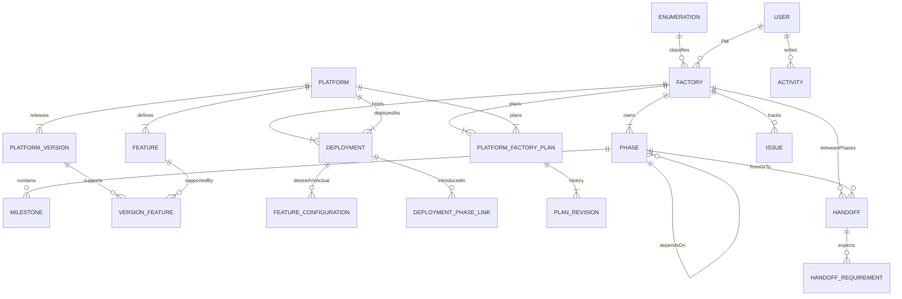

# 廠務協調台

P0 coordination workspace for several factories moving through the same four phases. The screen that matters most is **平台建立 (Phase 2)**: each factory × platform cell shows the deployment, the platform team's plan, and whether that cell can support the handoff into **開發者進駐**.

This repository is the Next.js client. Persistence and authorization are expected to move to a Go JSON service. Until that service exists, `src/api` serves the same paths from typed fixtures in the browser.

## Run

```bash
npm install
npm run dev
```

Open [http://localhost:3000](http://localhost:3000).

```bash
npm test    # handoff evaluator and construction windows
npm run lint
npm run build
```

This build is a single admin view. There is no user switcher and no per-role screen. The header can preview a slow or failed network and reset the demo. Edits stay in this browser tab. `X-Actor-Id` is still sent for the future Go service; the client always uses the seeded PM.

Point the client at Go by setting:

```bash
NEXT_PUBLIC_API_BASE_URL=http://localhost:8080
```

The client then `fetch`es the paths in [docs/openapi.yaml](docs/openapi.yaml) and sends `X-Actor-Id`.

## What you can do

| Screen | Path | What it is for |
| --- | --- | --- |
| 總覽 | `/` | Month-scale timeline of every factory, then exceptions: missing plans, windows outside Phase 2, blocked handoffs, overdue issues. Filter and group by 類別 / 區域 / 製程. |
| 平台建立 | `/platform-build` | Factory × platform grid. Status, versions, owners, machine counts, and Phase 2 → 3 readiness. |
| 工廠 | `/factories` | Per-factory month-and-week timeline, PM contact, discussion topics, plan windows, deployments, handoffs, issues. |
| 施工計畫 | `/factories/{id}/plans/{platformId}` | Version to provide, feature changes, construction window, revision history, submit and approve. |
| 交接 | `/handoffs` | Requirements evaluated against actual deployments. A person still accepts. |
| 問題 | `/issues` | Blockers tied to a factory, phase, platform, or handoff. |
| 平台 | `/platforms` | Global platforms: 開發部門, 專案部門, 主責, estimated machines. |
| 能力矩陣 | `/capabilities` | Supported by the actual version, desired, and reported actual. |
| 活動 / 設定 | `/activity`, `/settings` | Change history, and the category / region / technology enumerations. |

Default phases, copied onto each new factory and still editable there:

1. 硬體導入 Hardware Onboarding
2. 平台建立 Platform Build
3. 開發者進駐 Developer Onboarding
4. 開始營運 Operations Start

Seeded platforms: 運算 Compute, 儲存 Storage, 資料 Data, 開發 Developer, 監控 Monitoring.

Machine counts are planned quantities per machine type (機種A, 機種B, and any type added in 設定). Each factory × platform plan stores the breakdown. Screens show the computed total. There is no actual or delivered machine count. A factory page rolls the planned quantities up by type across its platforms.

## Rules that the screens follow

- **Exceptions first.** Missing plans, windows outside Phase 2, blocked or overdue handoffs, and open issues past the as-of date are ranked above factories that are quiet.
- **One factory, its own phases.** Templates are only a starting copy. Dates, owners, names, and extra phases belong to that factory.
- **Handoffs do not accept themselves.** `evaluateHandoffRequirements` reports whether `MIN_VERSION`, `FEATURE_ENABLED`, and `DEPLOYMENT_COMPLETE` are met. Moving to 已驗收 is a person, and unmet items must be acknowledged.
- **Versions compare numerically.** `2.10.0` is newer than `2.3.0`. A `v` prefix is ignored.
- **Capability is three facts.** A feature can be supported by the actual version, desired for this factory, and actually enabled. Those are not the same field.
- **Construction windows may overlap.** Platforms build in parallel. A window is flagged only when it is missing, or when it starts before or ends after that factory's Phase 2 dates. There is no overlap conflict.

The window check lives in `src/domain/windows.ts` and is covered by `src/domain/windows.test.ts`. Readiness for the Phase 2 → 3 handoff (`src/domain/readiness.ts`) still requires an approved plan, a window inside Phase 2, and a deployment that is `DEPLOYED` or `ACCEPTED`. An outside window can be submitted and approved; it just does not count as ready.

## Layout

```text
src/domain     pure TypeScript: types, semver, windows, readiness, handoff evaluation
src/mocks      demo fixtures
src/api        client, in-memory router, and view models shaped like the Go JSON
src/components screens
src/app        App Router pages
docs/openapi.yaml
```

`src/api/client.ts` is the only network seam. Pages never import fixtures. Mutations bump a revision counter so every open query refetches.

## Go contract

[docs/openapi.yaml](docs/openapi.yaml) is the request and response contract: factories, phases, milestones, handoffs and their transitions, issues, platforms, deployments, plans, feature diff, activity, and enumerations.

Plan and platform-build payloads include `windowState` (`MISSING` | `INSIDE` | `OUTSIDE`) and `windowReasons`. Allowed reasons are only:

- `MISSING_DATES`
- `MISSING_PHASE`
- `STARTS_BEFORE_PHASE`
- `ENDS_AFTER_PHASE`

Do not add an overlap reason. Two platforms whose windows share days are both `INSIDE` when each window sits inside Phase 2.

Errors are `{ "message": "..." }` with an HTTP status. The mock uses 404 for unknown resources and 503 for the header's failure preview.

## Data model



`PLATFORM_FACTORY_PLAN` is the per-factory submission: provided version, feature changes, construction window, and status `NOT_SUBMITTED` | `SUBMITTED` | `APPROVED`. `PLAN_REVISION` keeps each draft, submit, and approval. A factory deployment may set a secondary owner. Planned machine quantities live on that deployment, one number per machine type, and are edited with the plan. The total is the sum.

## Client app and a Go + htmx UI

Both can sit on this API. They are not equal fits for this product.

| | Next.js client (this repo) | Go templates + htmx |
| --- | --- | --- |
| Where it helps | The Phase 2 grid, capability matrix, timeline, and plan form recompute filters and window previews as the person types. | Settings, factory create/edit, issue status, and other forms that replace a fragment and do not keep a large client model. |
| Source of truth | Go JSON. The browser holds a view and a short-lived session copy of the demo. | Go JSON or HTML. The server renders the exception list and can share the same evaluators if they are ported. |
| Handoff and window rules | Pure TypeScript modules, unit-tested here, called again when the view model is built. | The same rules should live in Go so a template cannot drift from the API. Duplicating them only in the browser will drift. |
| Cost | A second runtime (Node) and a client bundle. Dense screens stay responsive without a round trip per keystroke. | One binary and progressive HTML. The factory × platform matrix, feature diff, and multi-filter board become a lot of partial endpoints and client script anyway. |

Recommendation: keep this client for the coordination boards, and implement the OpenAPI service in Go. Port `evaluateHandoffRequirements`, semver compare, and `evaluateConstructionWindow` into Go and test them there with the same cases (equal and higher versions, `2.10` vs `2.3`, missing window, window past Phase 2, two overlapping windows that are both inside). Use htmx later for simple form pages if a server-rendered slice is useful; do not split the Phase 2 grid across two UI stacks.

The mock is a stand-in, not the long-term store. Session reset and the fault switch exist so the screens can be reviewed before the Go service is up.
